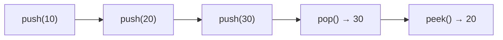
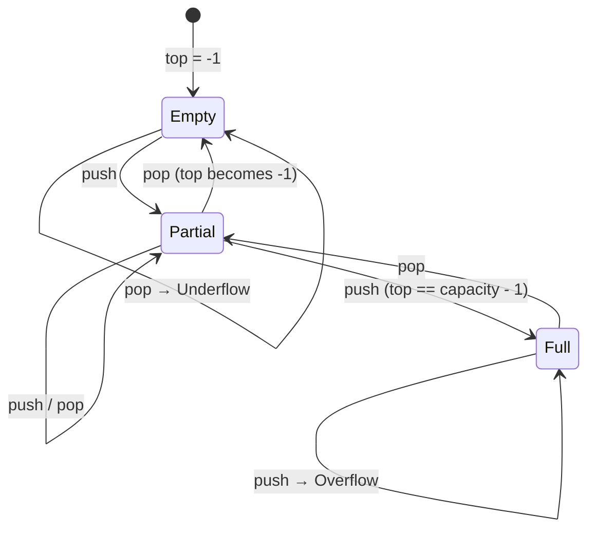
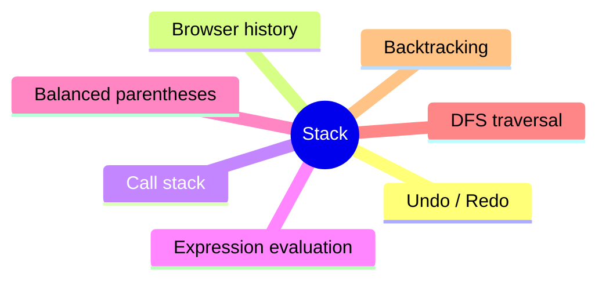

# 📚 Stack in Java

A **Stack** is a linear data structure that follows **LIFO (Last In, First Out)**: the last element added is the first one removed.

This folder contains two from-scratch implementations:

| File                       | Backing storage      | Capacity |
|----------------------------|----------------------|----------|
| `StackUsingArray.java`     | `int[]`              | Fixed    |
| `StackUsingArrayList.java` | `ArrayList<Integer>` | Dynamic  |

---

## 📖 Table of Contents

1. [How a Stack Works](#1-how-a-stack-works)
2. [Core Operations](#2-core-operations)
3. [Stack Using an Array](#3-stack-using-an-array)
4. [Stack Using an ArrayList](#4-stack-using-an-arraylist)
5. [Array vs ArrayList](#5-array-vs-arraylist)
6. [Common Use Cases](#6-common-use-cases)
7. [Common Mistakes](#7-common-mistakes)
8. [Complexity Summary](#8-complexity-summary)
9. [Practice Problems](#9-practice-problems)
10. [How to Run](#10-how-to-run)

---

## 1. How a Stack Works

Think of a stack of plates: you add and remove plates only from the **top**.

```text
   push(40) ──┐            ┌── pop() returns 40
              ▼            │
           ┌──────┐        │
   TOP ──► │  40  │ ◄──────┘
           ├──────┤
           │  30  │
           ├──────┤
           │  20  │
           ├──────┤
           │  10  │
           └──────┘
            BOTTOM
```

After `push(10)`, `push(20)`, `push(30)`:

```text
TOP -> 30
       20
       10
```

`pop()` removes and returns `30`. The new top is `20`.



---

## 2. Core Operations

| Operation     | Purpose                                          | Time   |
|---------------|--------------------------------------------------|--------|
| `push(value)` | Add a value to the top                           | `O(1)` |
| `pop()`       | Remove and return the top value                  | `O(1)` |
| `peek()`      | Read the top value without removing it           | `O(1)` |
| `isEmpty()`   | Check if the stack has no elements               | `O(1)` |
| `isFull()`    | Check if a fixed-size stack is full (array only) | `O(1)` |
| `display()`   | Print all elements                               | `O(n)` |

> For the `ArrayList` version, `push()` is **amortized** `O(1)` because the list occasionally resizes.

---

## 3. Stack Using an Array

An array has a **fixed capacity**. A variable `top` tracks the index of the current top element.

### Rules

- Start with `top = -1` (empty stack).
- **Push:** check `top == capacity - 1` (full?) → `top++` → `stack[top] = value`.
- **Pop:** check `top == -1` (empty?) → save `stack[top]` → `top--` → return saved value.
- **Peek:** return `stack[top]` without changing `top`.

### Push and pop trace (capacity = 5)

```text
Initially:  [  ][  ][  ][  ][  ]   top = -1

push(10):   [10][  ][  ][  ][  ]   top = 0
push(20):   [10][20][  ][  ][  ]   top = 1
push(30):   [10][20][30][  ][  ]   top = 2
pop():      [10][20][30][  ][  ]   top = 1   → returns 30
                     ▲
              stale value, ignored because top moved back
```

The old value stays in memory, but it is no longer part of the stack because `top` now points to index `1`.

### State diagram



### Overflow and underflow

| Situation               | Name                | Condition             |
|-------------------------|---------------------|-----------------------|
| Push onto a full stack  | **Stack Overflow**  | `top == capacity - 1` |
| Pop from an empty stack | **Stack Underflow** | `top == -1`           |

### Core code idea

```java
public void push(int value) {
    if (top == capacity - 1) {
        throw new IllegalStateException("Stack Overflow");
    }
    stack[++top] = value;
}

public int pop() {
    if (top == -1) {
        throw new IllegalStateException("Stack Underflow");
    }
    return stack[top--];
}

public int peek() {
    if (top == -1) {
        throw new IllegalStateException("Stack is empty");
    }
    return stack[top];
}
```

---

## 4. Stack Using an ArrayList

An `ArrayList` grows and shrinks automatically, so there is **no `top` variable** and **no fixed capacity**. The top of the stack is simply the **last element**.

```text
ArrayList:  index →  0    1    2
                   [10] [20] [30]
                              ▲
                        top = size() - 1
```

```java
// Push: add to the end
stack.add(value);

// Peek: read the last element
stack.get(stack.size() - 1);

// Pop: remove and return the last element
stack.remove(stack.size() - 1);

// Is empty?
stack.isEmpty();
```

> Always check `isEmpty()` before calling `get()` or `remove()` on the last index.

---

## 5. Array vs ArrayList

| Feature      | Array                              | ArrayList                       |
|--------------|------------------------------------|---------------------------------|
| Capacity     | Fixed when created                 | Grows automatically             |
| Top tracking | Manual `top` index                 | Last index is `size() - 1`      |
| Push         | `stack[++top] = value`             | `add(value)`                    |
| Pop          | `stack[top--]`                     | `remove(size() - 1)`            |
| Full check   | Required                           | Not needed                      |
| Storage      | Primitives (`int`)                 | Objects (`Integer`, autoboxing) |
| Memory       | Lower overhead                     | Slightly higher overhead        |
| Best for     | Learning internals, known max size | Convenience, unknown size       |

---

## 6. Common Use Cases



- **Undo/redo:** track recent actions.
- **Browser navigation:** the back button behaves like a stack.
- **Function calls:** the call stack tracks active methods and local variables.
- **Expression evaluation:** infix → postfix conversion and postfix evaluation.
- **Balanced parentheses:** push opening brackets, pop on closing ones.
- **Depth-First Search (DFS):** explicit stack instead of recursion.
- **Backtracking:** maze solving, N-Queens, etc.

---

## 7. Common Mistakes

1. Forgetting to check for **empty** before `pop()` or `peek()`.
2. Forgetting to check for **full** before `push()` in an array stack.
3. Off-by-one errors: the last valid index of an array of capacity `n` is `n - 1`.
4. Using `-1` as an error return value when `-1` can be a valid stack element. Prefer **exceptions** (or `Optional`) instead.
5. With `ArrayList<Integer>`, `remove(int index)` and `remove(Object o)` are different. Use `remove(stack.size() - 1)` to remove by **index**.
6. Confusing `peek()` (does **not** remove) with `pop()` (**removes**).

---

## 8. Complexity Summary

| Operation | Array stack   | ArrayList stack  |
|-----------|---------------|------------------|
| Push      | `O(1)`        | Amortized `O(1)` |
| Pop       | `O(1)`        | `O(1)`           |
| Peek      | `O(1)`        | `O(1)`           |
| isEmpty   | `O(1)`        | `O(1)`           |
| Display   | `O(n)`        | `O(n)`           |
| Space     | `O(capacity)` | `O(n)`           |

---

## 9. Practice Problems

- [ ] Reverse a string using a stack
- [ ] Check for balanced parentheses `()[]{}`
- [ ] Evaluate a postfix expression
- [ ] Convert infix to postfix
- [ ] Next Greater Element
- [ ] Implement a `MinStack` (get minimum in `O(1)`)
- [ ] Implement a stack using two queues
- [ ] Valid Parentheses (LeetCode 20)
- [ ] Min Stack (LeetCode 155)
- [ ] Daily Temperatures (LeetCode 739)

---

## 10. How to Run

```bash
javac StackUsingArray.java
java StackUsingArray

javac StackUsingArrayList.java
java StackUsingArrayList
```

---

## 📁 Files

- `StackUsingArray.java`
- `StackUsingArrayList.java`

---

> This README is part of my **Java DSA practice**. I am implementing data structures from scratch to understand their internal logic, operations, and complexity.
